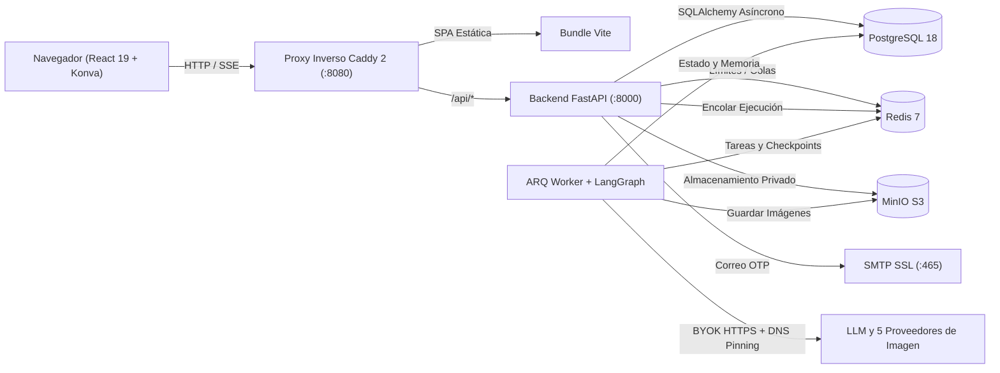

<div align="center">

# FlowCanvas

**Lienzo Infinito de IA y Estudio Creativo Multi-Agente de Código Abierto y Autoalojado**

*Espacio visual infinito · Generación y edición BYOK multi-proveedor · Orquestación LangGraph vía SSE · Seguridad de nivel producción*

[](./LICENSE)
[](./apps/api/pyproject.toml)
[](./apps/api)
[](./apps/worker)
[](./apps/web)
[](./infra/compose.yaml)

[English](./README.md) · [简体中文](./README.zh-CN.md) · [繁體中文](./README.zh-TW.md) · [日本語](./README.ja.md) · [한국어](./README.ko.md) · **Español**

<br />


</div>

---

## ¿Por qué FlowCanvas?

La mayoría de las herramientas de imagen con IA encierran al creador en un chat lineal, mientras que las pizarras clásicas añaden la IA como un complemento desconectado. **FlowCanvas** unifica un **lienzo infinito estilo galería Warm Ivory**, **generación de imágenes BYOK multi-proveedor** y un sistema **multi-agente LangGraph observable en tiempo real**, todo listo para autoalojamiento seguro con Docker Compose.

- **Creación centrada en el lienzo**: Desplazamiento y zoom fluidos, selección múltiple (`V`), pincel libre (`B`), texto en línea (`T`), alineación local y una capa dedicada `dragLayer` en Konva. Haz clic en cualquier imagen del lienzo para vincularla como referencia (`Ref 1 / Ref 2`).
- **Libertad total (Multi-BYOK)**: Adaptadores nativos para **Google Gemini (Nano Banana)**, **OpenAI (`gpt-image-1` / `gpt-image-2.5` y pasarelas compatibles)**, **Alibaba DashScope (`qwen-image-2.0`)**, **Volcengine Ark (`Seedream`)** y **SiliconFlow (`Kolors`)**, junto con cualquier LLM compatible con OpenAI.
- **Ejecución Multi-Agente observable (SSE v2)**: Sigue el flujo `Coordinator → Planner → Canvas Editor → Reviewer` con tarjetas de herramientas y pensamiento en vivo, memoria persistente **Harness** (`canvas_memories`) y deshacer en lote con un clic.
- **Seguridad para producción**: Cifrado Fernet de claves API, protección SSRF mediante DNS Pinning, limitación deslizante en Redis, bloqueos de fila en PostgreSQL y verificación de correo por código OTP vía SMTP SSL.

---

## Recorrido visual

<table>
  <tr>
    <td width="50%" valign="top">
      
      <p align="center"><b>Inicio del Estudio y Lanzador Rápido</b><br /><sub>Inicia un lienzo con 0, 1 o más imágenes de referencia y modelos preconfigurados.</sub></p>
    </td>
    <td width="50%" valign="top">
      
      <p align="center"><b>Lienzo Infinito y Colaboración Multi-Agente</b><br /><sub>Barra flotante, minimapa inferior, exportación PNG 2× limpia y memoria Harness en vivo.</sub></p>
    </td>
  </tr>
  <tr>
    <td width="50%" valign="top">
      
      <p align="center"><b>Centro de Modelos BYOK Multi-Proveedor</b><br /><sub>Gestiona múltiples adaptadores de imagen y LLMs con cifrado Fernet en reposo.</sub></p>
    </td>
    <td width="50%" valign="top">
      
      <p align="center"><b>Autenticación OTP por Correo y Sesiones</b><br /><sub>Registro con código de 6 dígitos, acceso por usuario o correo y restablecimiento que revoca sesiones.</sub></p>
    </td>
  </tr>
</table>

---

## Arquitectura del Sistema



---

## Inicio Rápido (Docker Compose)

```bash
git clone https://github.com/leileigwl/online-canvas-platform.git
cd online-canvas-platform
cp infra/compose.env.example .env
# Edita .env con APP_SECRET_KEY segura, contraseñas de DB/Redis/MinIO y ajustes SMTP
docker compose --project-directory "$PWD" -f infra/compose.yaml --env-file .env up -d --build
```

Abre **http://localhost:8080** en tu navegador. Consulta [`README.md`](./README.md) y [`docs/`](./docs) para instrucciones de desarrollo local (`uv` + `pnpm`) y arquitectura completa.

---

## Licencia

Distribuido bajo la licencia [MIT License](./LICENSE).
