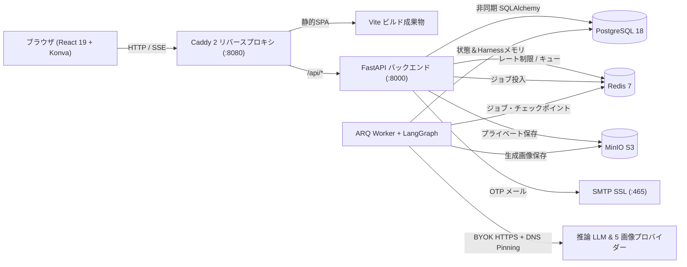

<div align="center">

# FlowCanvas

**オープンソース・セルフホスト対応 AI 無限キャンバス＆マルチエージェント制作スタジオ**

*無限ビジュアルワークスペース · マルチプロバイダー BYOK 画像生成・編集 · LangGraph SSE 協調レイアウト · 本番レベルのセキュリティ隔離*

[](./LICENSE)
[](./apps/api/pyproject.toml)
[](./apps/api)
[](./apps/worker)
[](./apps/web)
[](./infra/compose.yaml)

[English](./README.md) · [简体中文](./README.zh-CN.md) · [繁體中文](./README.zh-TW.md) · **日本語** · [한국어](./README.ko.md) · [Español](./README.es.md)

<br />


</div>

---

## FlowCanvas が選ばれる理由

多くの AI 画像ツールは制作フローを一方向のチャット欄に閉じ込め、従来のホワイトボードは AI を孤立したサイドバー機能として扱っています。**FlowCanvas** は、温かみのある **Warm Ivory 無限キャンバス**、**マルチプロバイダー BYOK 画像生成エンジン**、**可視化された LangGraph マルチエージェント協調システム** を 1 つのセルフホスト可能なフルスタック基盤へ統合しました。

- **キャンバス中心の制作フロー**: パン／ズーム、矩形選択（`V`）、フリーハンドブラシ（`B`）、インラインテキスト（`T`）、専用 `dragLayer` による滑らかな操作を実現。キャンバス上の画像をクリックするだけで参照画像（`Ref 1 / Ref 2`）として即座に紐付けられます。
- **ロックインなし（Multi-BYOK）**: **Google Gemini（Nano Banana）**、**OpenAI（`gpt-image-1` / `gpt-image-2.5` および互換ゲートウェイ）**、**Alibaba DashScope（`qwen-image-2.0`）**、**Volcengine Ark（`Seedream`）**、**SiliconFlow（`Kolors`）** の 5 種類の画像生成アダプターに加え、任意の OpenAI 互換推論 LLM を接続できます。
- **リアルタイムに観測可能なマルチエージェント実行**: `Coordinator → Planner → Canvas Editor → Reviewer` による思考トレースとツール呼び出しカードを **SSE v2** でリアルタイム配信。提案プレビューからワンクリックでの一括 Undo まで対応します。
- **本番運用に耐えるセキュリティ設計**: Fernet 暗号化によるキー保管（平文非返却）、DNS Pinning による SSRF 対策、Redis スライディングウィンドウレート制限、PostgreSQL 行ロック、SMTP メール認証 OTP を標準搭載。

---

## プロダクトツアー

<table>
  <tr>
    <td width="50%" valign="top">
      
      <p align="center"><b>スタジオホーム＆クイックランチャー</b><br /><sub>0/1/2+ 枚の参照画像とプリセットモデルを選んで即座にキャンバスを起動できます。</sub></p>
    </td>
    <td width="50%" valign="top">
      
      <p align="center"><b>無限キャンバス＆AI エージェント協調</b><br /><sub>フローティングツールバー、右下ミニマップ、UI なし 2× PNG エクスポート、Harness メモリを搭載。</sub></p>
    </td>
  </tr>
  <tr>
    <td width="50%" valign="top">
      
      <p align="center"><b>マルチプロバイダー BYOK モデルハブ</b><br /><sub>複数の画像生成エンドポイントと推論 LLM を Fernet 暗号化付きで一元管理。</sub></p>
    </td>
    <td width="50%" valign="top">
      
      <p align="center"><b>メール認証 OTP＆セッション管理</b><br /><sub>6 桁コード登録、メール／ユーザー名ログイン、全セッション無効化付きパスワード再設定に対応。</sub></p>
    </td>
  </tr>
</table>

---

## 主な機能

- **無限キャンバス (`React 19` + `Konva`)**: 専用 `dragLayer`、IndexedDB 下書き復元、スナップショット履歴、`Delete` 削除、ミニマップ、クリーンな 2× PNG 書き出し。
- **5 つの画像生成プロトコル**: Google Gemini / Nano Banana (最大 14 枚・2K/4K)、OpenAI (`gpt-image-1` / `2.5`・最大 16 枚)、DashScope (`qwen-image-2.0`)、Volcengine Ark (`Seedream`)、SiliconFlow (`Kolors`)。生成画像はプライベート **MinIO / S3** へ自動保存。
- **LangGraph + Harness メモリ**: ホワイトリスト化された 8 つのキャンバスツール（`add_note`, `add_text`, `move_object`, `resize_object`, `align_objects`, `add_shape`, `generate_image`, `edit_image`）とトークン予算 **65%** での自動コンテキスト圧縮。
- **メール認証と多層防御**: SMTP SSL OTP（10 分有効・60 秒クールダウン・5 回ロック）、ユーザー単位の厳格なデータ隔離、SSRF 防御。

---

## システム構成



---

## クイックスタート（Docker Compose）

```bash
git clone https://github.com/leileigwl/online-canvas-platform.git
cd online-canvas-platform
cp infra/compose.env.example .env
# .env の APP_SECRET_KEY、DB/Redis/MinIO パスワード、SMTP 設定を編集
docker compose --project-directory "$PWD" -f infra/compose.yaml --env-file .env up -d --build
```

起動後、ブラウザで **http://localhost:8080** にアクセスしてください。ローカル開発手順（`uv` + `pnpm`）や詳細な設計ドキュメントは [`README.md`](./README.md) および [`docs/`](./docs) をご参照ください。

---

## ライセンス

[MIT License](./LICENSE) の下で公開されています。
