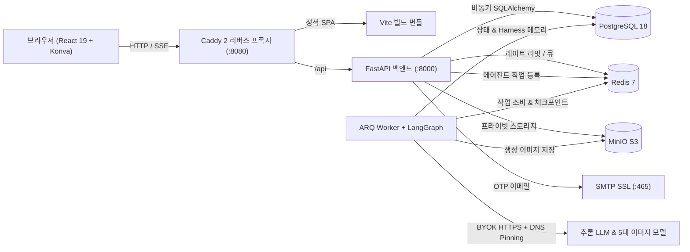

<div align="center">

# FlowCanvas

**오픈소스 셀프 호스팅 AI 무한 캔버스 & 멀티 에이전트 크리에이티브 스튜디오**

*무한 비주얼 워크스페이스 · 멀티 프로바이더 BYOK 이미지 생성 및 편집 · LangGraph SSE 협업 오케스트레이션 · 프로덕션 보안 격리*

[](./LICENSE)
[](./apps/api/pyproject.toml)
[](./apps/api)
[](./apps/worker)
[](./apps/web)
[](./infra/compose.yaml)

[English](./README.md) · [简体中文](./README.zh-CN.md) · [繁體中文](./README.zh-TW.md) · [日本語](./README.ja.md) · **한국어** · [Español](./README.es.md)

<br />


</div>

---

## 왜 FlowCanvas인가요?

대부분의 AI 이미지 도구는 작업을 일방향 채팅창에 가두고, 기존 화이트보드는 AI를 분리된 사이드바 플러그인으로 취급합니다. **FlowCanvas**는 감각적인 **Warm Ivory 무한 캔버스**, **멀티 프로바이더 BYOK 이미지 생성 엔진**, **관찰 가능한 LangGraph 멀티 에이전트 협업**을 자체 호스팅 가능한 보안 강화 풀스택 플랫폼으로 통합합니다.

- **캔버스 중심 창작 워크플로**: 독립 Konva `dragLayer` 기반의 부드러운 이동/확대, 다중 선택(`V`), 자유 브러시(`B`), 인라인 텍스트(`T`), 그리드 정렬 지원. 캔버스 이미지를 클릭하는 것만으로 이미지-투-이미지 레퍼런스(`Ref 1 / Ref 2`)로 즉시 연결할 수 있습니다.
- **벤더 종속 없는 Multi-BYOK**: **Google Gemini (Nano Banana)**, **OpenAI (`gpt-image-1` / `gpt-image-2.5` 및 호환 게이트웨이)**, **Alibaba DashScope (`qwen-image-2.0`)**, **Volcengine Ark (`Seedream`)**, **SiliconFlow (`Kolors`)** 5개 이미지 어댑터와 OpenAI 호환 추론 LLM을 지원합니다.
- **실시간 멀티 에이전트 실행 (SSE v2)**: `Coordinator → Planner → Canvas Editor → Reviewer`의 사고 과정과 화이트리스트 툴 호출 카드를 실시간 스트리밍으로 확인하고, 제안 미리보기 및 원클릭 일괄 실행 취소가 가능합니다.
- **프로덕션 보안 설계**: Fernet API 키 암호화(평문 미노출), DNS Pinning 기반 SSRF 방어, Redis 슬라이딩 윈도우 레이트 리밋, PostgreSQL 행 잠금, SMTP 이메일 OTP 인증을 제공합니다.

---

## 주요 화면 둘러보기

<table>
  <tr>
    <td width="50%" valign="top">
      
      <p align="center"><b>스튜디오 홈 & 빠른 프롬프트 런처</b><br /><sub>0/1/2+장의 참조 이미지와 모델 프리셋으로 즉시 캔버스를 시작할 수 있습니다.</sub></p>
    </td>
    <td width="50%" valign="top">
      
      <p align="center"><b>무한 캔버스 & AI 에이전트 협업</b><br /><sub>플로팅 툴바, 우측 하단 미니맵, UI 없는 2× PNG 내보내기, Harness 메모리 사이드바를 제공합니다.</sub></p>
    </td>
  </tr>
  <tr>
    <td width="50%" valign="top">
      
      <p align="center"><b>멀티 프로바이더 BYOK 모델 허브</b><br /><sub>여러 이미지 모델 엔드포인트와 추론 LLM을 Fernet 암호화와 함께 안전하게 관리합니다.</sub></p>
    </td>
    <td width="50%" valign="top">
      
      <p align="center"><b>이메일 OTP 인증 & 세션 보안</b><br /><sub>6자리 코드 회원가입, 아이디/이메일 로그인, 전체 세션 만료 기반 비밀번호 재설정을 지원합니다.</sub></p>
    </td>
  </tr>
</table>

---

## 시스템 아키텍처



---

## 빠른 시작 (Docker Compose)

```bash
git clone https://github.com/leileigwl/online-canvas-platform.git
cd online-canvas-platform
cp infra/compose.env.example .env
# .env 파일에서 APP_SECRET_KEY, DB/Redis/MinIO 비밀번호 및 SMTP 설정을 수정하세요
docker compose --project-directory "$PWD" -f infra/compose.yaml --env-file .env up -d --build
```

실행 후 브라우저에서 **http://localhost:8080** 으로 접속하세요. 로컬 개발(`uv` + `pnpm`) 및 아키텍처 문서는 [`README.md`](./README.md)와 [`docs/`](./docs)를 참고하시기 바랍니다.

---

## 라이선스

[MIT License](./LICENSE)로 배포됩니다.
