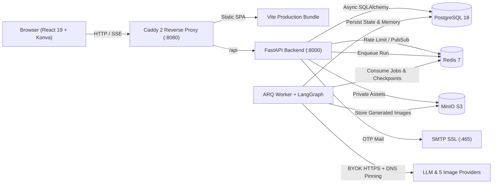

<div align="center">

# FlowCanvas

**Open-Source, Self-Hosted AI Infinite Canvas & Multi-Agent Creative Studio**

*Infinite visual workspace · Multi-provider BYOK image generation & editing · LangGraph multi-agent SSE orchestration · Production security*

[](./LICENSE)
[](./apps/api/pyproject.toml)
[](./apps/api)
[](./apps/worker)
[](./apps/web)
[](./infra/compose.yaml)

**English** · [简体中文](./README.zh-CN.md) · [繁體中文](./README.zh-TW.md) · [日本語](./README.ja.md) · [한국어](./README.ko.md) · [Español](./README.es.md)

<br />


</div>

---

## Why FlowCanvas?

Most AI image tools lock creators into a linear chat feed, while traditional whiteboards treat AI as a disconnected sidebar plugin. **FlowCanvas** unifies a tactile **Warm Ivory infinite canvas**, **multi-provider BYOK image generation**, and a **collaborative LangGraph multi-agent system** inside a self-hostable, security-hardened full-stack platform.

- **Canvas-First Creation**: Pan, zoom, group-select, sketch (`B`), annotate (`T`), align grids, and drop reference images directly on an isolated Konva drag layer—click any canvas card to silently bind it as `Ref 1 / Ref 2` for image-to-image generation.
- **Zero Lock-In (Multi-BYOK)**: Bring your own keys for **Google Gemini (Nano Banana)**, **OpenAI (`gpt-image-1` / `gpt-image-2.5` & gateways)**, **Alibaba DashScope (`qwen-image-2.0`)**, **Volcengine Ark (`Seedream`)**, and **SiliconFlow (`Kolors`)**, alongside any OpenAI-compatible reasoning LLM (`DeepSeek`, `OpenAI`, etc.).
- **Observable Multi-Agent Execution**: Watch `Coordinator → Planner → Canvas Editor → Reviewer` think, plan, and call spatial/generation tools over **SSE v2** in real time, then preview changes on the canvas or undo an entire agent batch in one click.
- **Ready for Production Self-Hosting**: Strict per-user tenant isolation, Fernet-encrypted API keys, DNS-pinned SSRF protection, Redis sliding-window rate limits, PostgreSQL row locks, and built-in SMTP OTP email verification.

---

## Product Tour

<table>
  <tr>
    <td width="50%" valign="top">
      
      <p align="center"><b>Studio Home & Quick Prompt Launcher</b><br /><sub>Launch straight into a blank infinite canvas or seed a project with reference images and model presets.</sub></p>
    </td>
    <td width="50%" valign="top">
      
      <p align="center"><b>Infinite Canvas & Agent Collaboration</b><br /><sub>Warm Ivory gallery workspace with floating tools, Minimap, clean 2× PNG export, and live Harness memory sidebar.</sub></p>
    </td>
  </tr>
  <tr>
    <td width="50%" valign="top">
      
      <p align="center"><b>Multi-Provider BYOK Model Hub</b><br /><sub>Configure multiple named image endpoints + LLM reasoning models with Fernet encryption at rest.</sub></p>
    </td>
    <td width="50%" valign="top">
      
      <p align="center"><b>Email OTP Auth & Session Security</b><br /><sub>6-digit email verification, username-or-email sign-in, password reset session revocation, and legacy email binding.</sub></p>
    </td>
  </tr>
</table>

---

## Core Capabilities

### 1. Infinite Canvas Workspace (`React 19` + `Konva`)
- **Smooth Hardware-Isolated Rendering**: Dedicated `dragLayer` keeps drag-and-drop fluid without jitter or snap-back even on dense boards.
- **Complete Creative Toolkit**: Select/marquee (`V`), hand pan (`H` / `Space`), inline canvas text (`T`) with zero-artifact cleanup, freehand brush (`B`), sticky notes, local multi-select grid alignment, `Delete` shortcut, snapshot version history, and **2× UI-free PNG export**.
- **Resilient State**: IndexedDB asynchronous draft recovery + bottom-right interactive Minimap + optimistic revision control (`base_revision`).

### 2. Multi-Provider Image Generation & Editing (`5` Adapters)

| Provider Adapter | Supported Models & Highlights | Multi-Reference Capability |
| :--- | :--- | :--- |
| **Google Gemini / Nano Banana** | `gemini-2.5-flash-image`, `gemini-3.1-flash-image`, `Imagen 4` | Native `:generateContent` inline fusion (up to 14 refs, 2K/4K) |
| **OpenAI & Compatible** | `gpt-image-1`, `gpt-image-2.5` + chat-completions gateway fallback | `/images/generations` & `/images/edits` (up to 16 refs) |
| **Alibaba DashScope** | `qwen-image-2.0` | 1–3 image fusion preserving target aspect ratio |
| **Volcengine Ark** | `Seedream` series | Prompt-driven generation & multi-ref editing |
| **SiliconFlow** | `Kolors`, `Qwen-Image` | Fast open-weights text-to-image & editing |

- **Context-Aware Parameter Bar**: Dynamically adapts controls for `0` (text-to-image), `1`, or `2+` selected canvas reference images.
- **Private Object Storage**: Generated artwork is automatically stored in private **MinIO / S3** and linked back onto the canvas without leaking external URLs.

### 3. LangGraph Multi-Agent Orchestration & Harness Memory
- **4-Role Pipeline**: `Coordinator` (decomposes into up to 3 dependency-linked subtasks) → `Planner` → `Canvas Editor` → `Reviewer`.
- **8 Whitelisted Canvas Tools**: `add_note`, `add_text`, `move_object`, `resize_object`, `align_objects`, `add_shape`, `generate_image`, and `edit_image`—never exposing arbitrary code execution.
- **SSE v2 Streaming**: Real-time **Thinking Trace** + **Tool Call Cards** streamed via LangGraph `stream_mode=["updates", "custom"]`.
- **Harness Canvas Memory**: Persists long-running creative decisions per canvas (`canvas_memories`) and automatically summarizes/compacts context at **65% token budget**.

### 4. Authentication & Production Security
- **Email Verification Lifecycle**: SSL/STARTTLS SMTP OTP (`6-digit`, 10-min TTL, 60s resend cooldown, 5-attempt lockout, HMAC-SHA256 hashed in PostgreSQL), login via username or verified email, password reset revoking all active sessions, and `/account` verified email binding.
- **Defense in Depth**: Fernet key encryption (write-only API keys, never echoed), HTTPS-only public-IP DNS pinning against SSRF, Redis sliding-window rate limits, MIME/magic-byte upload verification, and per-account resource ownership checks.

---

## System Architecture



---

## Quick Start

### Option A: Docker Compose (Recommended — Full 6-Service Stack)

**Prerequisites**: Docker & Docker Compose (`Postgres`, `Redis`, `MinIO`, `API`, `ARQ Worker`, `Caddy Web`).

```bash
# 1. Clone the repository
git clone https://github.com/leileigwl/online-canvas-platform.git
cd online-canvas-platform

# 2. Create environment config and customize secrets / SMTP
cp infra/compose.env.example .env
# Edit .env: set strong APP_SECRET_KEY, DB/Redis/MinIO passwords, and optional SMTP_* keys

# 3. Build and start all services
docker compose --project-directory "$PWD" -f infra/compose.yaml --env-file .env up -d --build

# 4. Verify container health
docker compose --project-directory "$PWD" -f infra/compose.yaml --env-file .env ps
```

Open **http://localhost:8080** in your browser.
> Backup and restore scripts are provided in [`infra/backup.sh`](./infra/backup.sh) and [`infra/restore.sh`](./infra/restore.sh).

<details>
<summary><b>Option B: Local Development Setup (<code>uv</code> + <code>pnpm</code>)</b></summary>

```bash
# 1. Copy local env template
cp .env.example .env

# 2. Install Python workspace dependencies & run Alembic migrations
uv sync --all-packages --extra dev
cd apps/api && ../../.venv/bin/alembic upgrade head && cd ../..

# 3. Start FastAPI (:8001) and ARQ Worker
pnpm dev:api
pnpm dev:worker

# 4. Install frontend dependencies & start Vite dev server (:5173)
pnpm install
pnpm dev

# 5. (Optional) Seed a demo gallery account
uv run python -m canvas_api.seed_demo --username demo_creator --password '<your-password>'

# 6. Run linters, tests, typecheck & build
uv run ruff check apps/api apps/worker
uv run pytest apps/api/tests apps/worker/tests -v
pnpm typecheck && pnpm build
```

</details>

---

## Project Structure

```text
online-canvas-platform/
├── apps/
│   ├── api/                 # FastAPI app, Alembic migrations, SMTP service, 5 image adapters, pytest suite
│   ├── worker/              # ARQ background worker & LangGraph multi-agent orchestration + Harness memory
│   └── web/                 # React 19 + Vite SPA (Studio Home, Konva Canvas, BYOK Settings, Auth Pages)
├── packages/
│   ├── api-client/          # Typed frontend API client
│   └── canvas-core/         # Shared canvas document schemas & types
├── infra/                   # Docker Compose topology, Caddyfile, MinIO init, backup & restore scripts
└── docs/                    # PRD, system architecture, prototypes, and README visual assets
```

---

## Documentation Index

- [`AGENTS.md`](./AGENTS.md) — Engineering conventions & repository map
- [`docs/PRODUCT.md`](./docs/PRODUCT.md) — Product scope, BYOK boundaries & roadmap
- [`docs/ARCHITECTURE.md`](./docs/ARCHITECTURE.md) — Service topology & security red lines
- [`docs/01-product/PRD.md`](./docs/01-product/PRD.md) — Detailed product requirements
- [`docs/02-design/system-architecture.md`](./docs/02-design/system-architecture.md) — Database schema, API contracts & reverse-proxy SSE guide

---

## License

Released under the [MIT License](./LICENSE).
