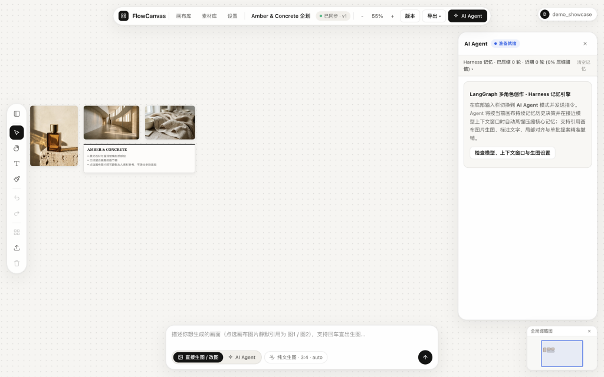
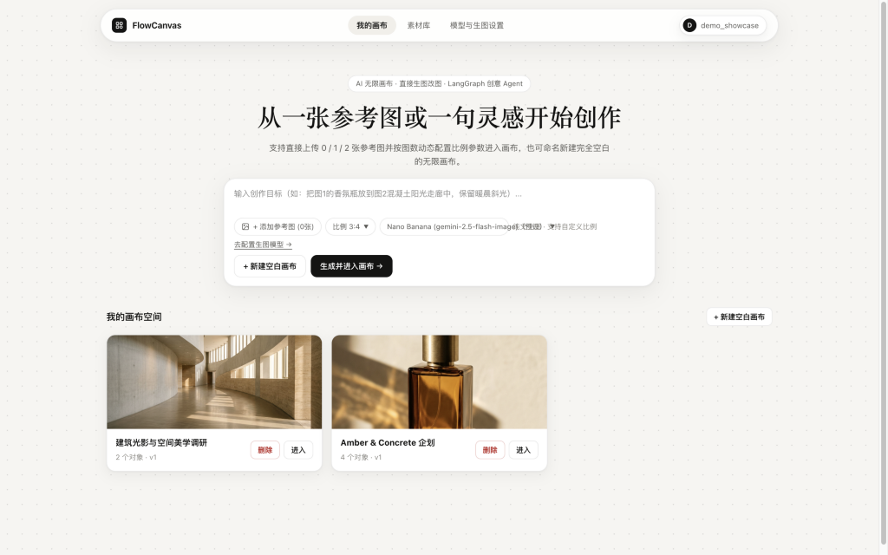
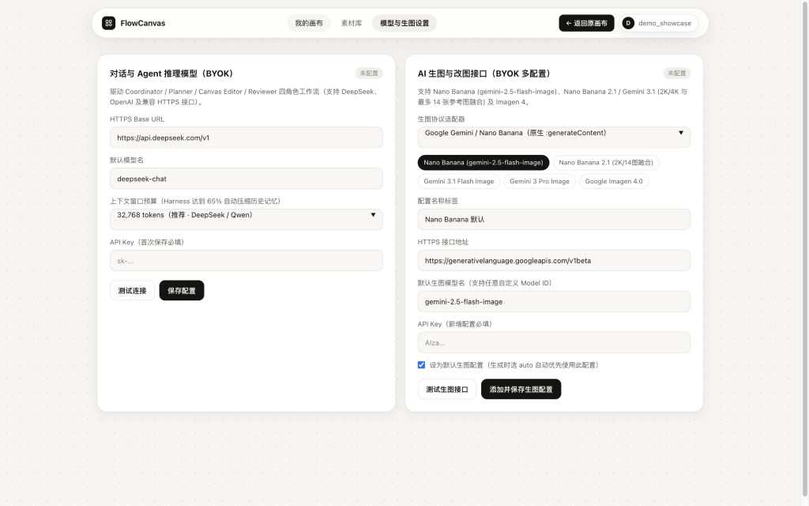
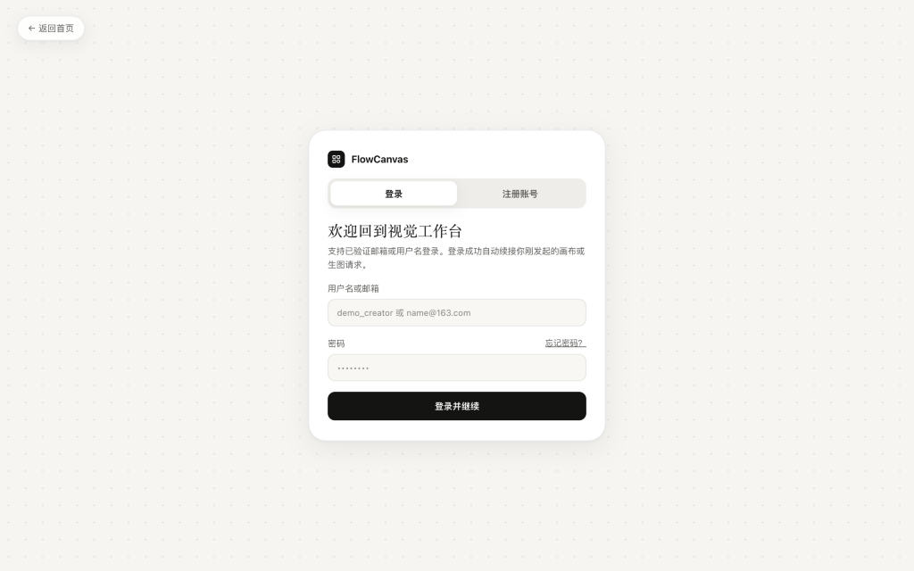
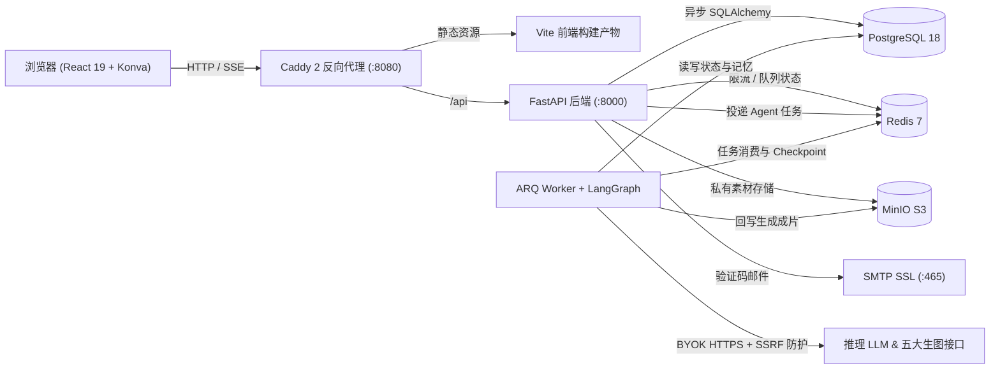

<div align="center">

# FlowCanvas

**开源可自托管的 AI 无限画布与多 Agent 视觉创作工作台**

*无限视觉空间 · 多协议 BYOK 生图与改图 · LangGraph 多智能体 SSE 协同排版 · 生产级安全隔离*

[](./LICENSE)
[](./apps/api/pyproject.toml)
[](./apps/api)
[](./apps/worker)
[](./apps/web)
[](./infra/compose.yaml)

[English](./README.md) · **简体中文** · [繁體中文](./README.zh-TW.md) · [日本語](./README.ja.md) · [한국어](./README.ko.md) · [Español](./README.es.md)

<br />



</div>

---

## 为什么选择 FlowCanvas？

大多数 AI 生图工具把创作局限在单向聊天框里，而传统白板又只把 AI 当作割裂的侧边栏插件。**FlowCanvas** 将 **暖象牙画廊风无限画布**、**多厂商 BYOK 生图改图引擎** 与 **可观测的 LangGraph 多角色 Agent 协作** 融为一体，并支持一套完整的 Docker Compose 私有化部署。

- **以画布为中心的创作流**：支持自由平移缩放、框选多选、涂鸦画笔（`B`）、原位文字（`T`）与独立拖拽层；在画布上点击任意图片即可静默绑定为 `图1 / 图2` 参考图进行生图或改图。
- **拒绝厂商绑定（Multi-BYOK）**：原生支持 **Google Gemini / Nano Banana**、**OpenAI（`gpt-image-1` / `gpt-image-2.5` 及聚合网关）**、**阿里百炼（`qwen-image-2.0`）**、**火山方舟（`Seedream`）** 与 **硅基流动（`Kolors`）** 五大生图协议，同时可接入任意 OpenAI 兼容推理模型（`DeepSeek` 等）。
- **透明可控的多智能体协同**：基于 LangGraph `Coordinator → Planner → Canvas Editor → Reviewer` 四角色链路与 **SSE v2** 实时流，右侧实时展示 **Thinking 思考过程** 与 **工具调用卡片**，支持提案预览与整批一键撤销。
- **开箱即用的生产级安全**：Fernet 密钥加密存储（绝不回显）、公网 HTTPS + DNS Pinning 防 SSRF、Redis 滑动窗口限流、PostgreSQL 行锁防并发篡改，以及开箱即用的 SMTP 邮箱验证码认证闭环。

---

## 界面总览

<table>
  <tr>
    <td width="50%" valign="top">
      
      <p align="center"><b>创作首页与快捷启动栏</b><br /><sub>支持携 0/1/2+ 张参考图与预设模型直接进入画布，或随时新建空白灵感空间。</sub></p>
    </td>
    <td width="50%" valign="top">
      
      <p align="center"><b>无限画布与 Agent 实时协同</b><br /><sub>配备悬浮工具栏、右下角全局缩略图 Minimap、2× 无框整图导出与右侧 Harness 记忆引擎。</sub></p>
    </td>
  </tr>
  <tr>
    <td width="50%" valign="top">
      
      <p align="center"><b>多协议 BYOK 模型中心</b><br /><sub>可同时管理多套命名生图配置与推理 LLM，密钥采用 Fernet 加密落库保存。</sub></p>
    </td>
    <td width="50%" valign="top">
      
      <p align="center"><b>邮箱验证码认证与会话管理</b><br /><sub>支持 6 位验证码注册、用户名/邮箱登录、忘记密码重置并吊销全部旧会话，以及账户邮箱绑定。</sub></p>
    </td>
  </tr>
</table>

---

## 核心特性

### 1. 无限画布工作台（`React 19` + `Konva`）
- **独立拖拽层隔离**：专用 `dragLayer` 保证复杂画板下拖拽顺滑无回弹抖动。
- **完整编辑能力**：选择/框选（`V`）、抓手平移（`H` / `Space`）、原位富文本（`T`，删空自动清理边框）、自由画笔（`B`）、便签卡片、局部网格对齐、`Delete` 快捷键、历史版本快照，以及 **2× 无 UI 边框整画布 PNG 导出**。
- **数据高可靠**：IndexedDB 异步草稿自动恢复 + 右下角实时全局 Minimap + 基于 `base_revision` 的乐观并发控制。

### 2. 五大 AI 生图与改图协议适配器

| 协议适配器 | 支持模型与亮点 | 参考图与融图能力 |
| :--- | :--- | :--- |
| **Google Gemini / Nano Banana** | `gemini-2.5-flash-image`、`gemini-3.1-flash-image`、`Imagen 4` | 原生 `:generateContent` 内联融图（最高 14 图，2K/4K） |
| **OpenAI 及兼容网关** | `gpt-image-1`、`gpt-image-2.5` + 对话聚合端点自动兜底 | `/images/generations` 与 `/images/edits`（最高 16 图） |
| **阿里百炼 DashScope** | `qwen-image-2.0` | 支持 1–3 张参考图融合，自动保持末图比例 |
| **火山方舟 Volcengine Ark** | `Seedream` 系列 | 支持文生图与参考图改图 |
| **硅基流动 SiliconFlow** | `Kolors`、`Qwen-Image` | 快速开源文生图与图像编辑 |

- **上下文自适应参数栏**：按 `0`（纯文生图）、`1` 或 `2+` 张选中参考图动态呈现参数，减少界面干扰。
- **私有对象存储托管**：生成成片自动转存至私有 **MinIO / S3** 并回填画布，避免外部链接失效。

### 3. LangGraph 多智能体协作与 Harness 记忆引擎
- **四角色协作管线**：`Coordinator`（拆解最多 3 个带依赖的子任务）→ `Planner` → `Canvas Editor` → `Reviewer`。
- **8 个受限白名单画布工具**：`add_note`、`add_text`、`move_object`、`resize_object`、`align_objects`、`add_shape`、`generate_image`、`edit_image`，确保执行可控安全。
- **SSE v2 实时透明输出**：基于 LangGraph `stream_mode=["updates", "custom"]` 实时推送思考轨迹与工具调用状态卡片。
- **Harness 画布记忆**：按画布持久化长期创作决策（`canvas_memories`），达到 **65% Token 预算** 时自动蒸馏压缩上下文历史。

### 4. 邮箱认证与生产级安全防线
- **完整邮箱验证码链路**：支持 163 / 标准 SMTP SSL（`6` 位数字、10 分钟有效、60 秒冷却、5 次错误锁定、PostgreSQL 存储 HMAC-SHA256 摘要），支持用户名或已验证邮箱登录、重置密码全端踢下线，以及 `/account` 绑定或更换邮箱。
- **纵深防御体系**：Fernet 密钥加密、公网 HTTPS + DNS Pinning 防 SSRF、Redis 滑动窗口限流、文件头 Magic Bytes 校验防伪造上传、严格按账户隔离项目/画布/素材。

---

## 系统架构



---

## 快速开始

### 方式一：Docker Compose 一键部署（推荐，6 服务完整架构）

**环境要求**：Docker 与 Docker Compose（包含 `Postgres`、`Redis`、`MinIO`、`API`、`ARQ Worker`、`Caddy Web`）。

```bash
# 1. 克隆仓库
git clone https://github.com/leileigwl/online-canvas-platform.git
cd online-canvas-platform

# 2. 复制环境配置并修改密钥与可选的 SMTP 发信参数
cp infra/compose.env.example .env
# 编辑 .env：配置强随机 APP_SECRET_KEY、数据库/Redis/MinIO 密码及 SMTP_* 配置

# 3. 构建并后台启动全栈服务
docker compose --project-directory "$PWD" -f infra/compose.yaml --env-file .env up -d --build

# 4. 查看容器健康状态
docker compose --project-directory "$PWD" -f infra/compose.yaml --env-file .env ps
```

启动完成后打开浏览器访问 **http://localhost:8080** 即可使用。
> 生产备份与恢复脚本位于 [`infra/backup.sh`](./infra/backup.sh) 与 [`infra/restore.sh`](./infra/restore.sh)。

<details>
<summary><b>方式二：本地源码开发调试（<code>uv</code> + <code>pnpm</code>）</b></summary>

```bash
# 1. 复制本地开发配置
cp .env.example .env

# 2. 安装 Python 工作区依赖并执行数据库迁移
uv sync --all-packages --extra dev
cd apps/api && ../../.venv/bin/alembic upgrade head && cd ../..

# 3. 启动 FastAPI (:8001) 与 ARQ Worker
pnpm dev:api
pnpm dev:worker

# 4. 安装前端依赖并启动 Vite 开发服务器 (:5173)
pnpm install
pnpm dev

# 5. （可选）一键预置演示画廊账号与示例素材
uv run python -m canvas_api.seed_demo --username demo_creator --password '<your-password>'

# 6. 运行代码检查、测试与构建验证
uv run ruff check apps/api apps/worker
uv run pytest apps/api/tests apps/worker/tests -v
pnpm typecheck && pnpm build
```

</details>

---

## 目录结构

```text
online-canvas-platform/
├── apps/
│   ├── api/                 # FastAPI 服务、Alembic 迁移、SMTP 邮件服务、5 大生图适配器与 pytest 测试
│   ├── worker/              # ARQ 异步 Worker、LangGraph 多智能体编排与 Harness 记忆引擎
│   └── web/                 # React 19 + Vite 前端应用（首页、Konva 无限画布、BYOK 设置、认证页面）
├── packages/
│   ├── api-client/          # 前后端强类型 API Client
│   └── canvas-core/         # 共享画布文档 Schema 与类型定义
├── infra/                   # Docker Compose 编排、Caddyfile、MinIO 初始化与备份恢复脚本
└── docs/                    # PRD、系统架构契约、原型图与 README 演示截图
```

---

## 文档导航

- [`AGENTS.md`](./AGENTS.md) — 工程开发规范与工作入口
- [`docs/PRODUCT.md`](./docs/PRODUCT.md) — 产品定位、BYOK 边界与能力规划
- [`docs/ARCHITECTURE.md`](./docs/ARCHITECTURE.md) — 服务拓扑与安全红线约束
- [`docs/01-product/PRD.md`](./docs/01-product/PRD.md) — 完整产品需求文档
- [`docs/02-design/system-architecture.md`](./docs/02-design/system-architecture.md) — 表结构、接口契约与反代 SSE 配置说明

---

## 开源协议

本项目基于 [MIT License](./LICENSE) 开源。
