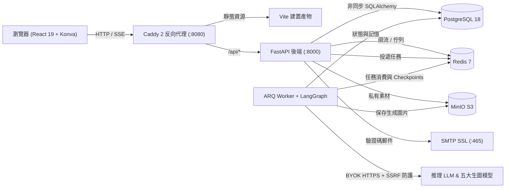

<div align="center">

# FlowCanvas

**開源可自託管的 AI 無限畫布與多 Agent 視覺創作工作台**

*無限視覺空間 · 多協議 BYOK 生圖與改圖 · LangGraph 多智能體 SSE 協同排版 · 生產級安全隔離*

[](./LICENSE)
[](./apps/api/pyproject.toml)
[](./apps/api)
[](./apps/worker)
[](./apps/web)
[](./infra/compose.yaml)

[English](./README.md) · [简体中文](./README.zh-CN.md) · **繁體中文** · [日本語](./README.ja.md) · [한국어](./README.ko.md) · [Español](./README.es.md)

<br />


</div>

---

## 為什麼選擇 FlowCanvas？

多數 AI 生圖工具將創作限制在線性對話框中，而傳統白板又僅把 AI 當作割裂的側邊欄外掛。**FlowCanvas** 將 **暖象牙畫廊風無限畫布**、**多供應商 BYOK 生圖改圖引擎** 與 **可觀測的 LangGraph 多角色 Agent 協作** 整合進可私有部署的全端平台。

- **以畫布為核心的創作體驗**：支援自由平移縮放、框選多選、自由畫筆（`B`）、原位文字編輯（`T`）與獨立拖拽圖層；在畫布上點選圖片即可靜默綁定為 `圖1 / 圖2` 參考圖進行生成與編輯。
- **多供應商自由切換（Multi-BYOK）**：內建 **Google Gemini / Nano Banana**、**OpenAI（`gpt-image-1` / `gpt-image-2.5` 與相容閘道）**、**阿里百煉（`qwen-image-2.0`）**、**火山方舟（`Seedream`）** 及 **矽基流動（`Kolors`）** 五大生圖協議適配器，並支援任何 OpenAI 相容推理模型。
- **透明可控的多智能體協作**：由 `Coordinator → Planner → Canvas Editor → Reviewer` 透過 **SSE v2** 即時串流 **Thinking 思考過程** 與 **工具呼叫卡片**，支援畫布預覽套用與整批一鍵復原。
- **生產級安全與隔離**：Fernet 金鑰加密（絕不回顯明文）、公網 HTTPS + DNS Pinning 防 SSRF、Redis 滑動視窗限流、PostgreSQL 列鎖與 SMTP 郵箱驗證碼註冊登入閉環。

---

## 介面導覽

<table>
  <tr>
    <td width="50%" valign="top">
      
      <p align="center"><b>創作首頁與快速啟動欄</b><br /><sub>可帶入 0/1/2+ 張參考圖與預設模型直接建立畫布，或一鍵開啟空白靈感空間。</sub></p>
    </td>
    <td width="50%" valign="top">
      
      <p align="center"><b>無限畫布與 Agent 即時協同</b><br /><sub>提供懸浮工具列、右下角全域縮略圖 Minimap、2× 無邊框整畫布匯出與 Harness 記憶側欄。</sub></p>
    </td>
  </tr>
  <tr>
    <td width="50%" valign="top">
      
      <p align="center"><b>多協議 BYOK 模型中心</b><br /><sub>集中管理多組生圖設定與推理模型，所有 API Key 皆以 Fernet 加密儲存。</sub></p>
    </td>
    <td width="50%" valign="top">
      
      <p align="center"><b>郵箱驗證碼認證與會話安全</b><br /><sub>支援 6 位數字驗證碼註冊、使用者名稱或郵箱登入、忘記密碼重設並註銷所有舊會話。</sub></p>
    </td>
  </tr>
</table>

---

## 核心功能

### 1. 無限畫布工作台（`React 19` + `Konva`）
- **獨立拖拽圖層隔離**：專用 `dragLayer` 確保多物件畫布拖拽流暢、無回彈抖動。
- **完整創作工具組**：選取/框選（`V`）、抓手平移（`H` / `Space`）、原位文字（`T`）、自由畫筆（`B`）、便籤卡片、局部網格對齊、`Delete` 刪除、歷史版本快照與 **2× 無 UI 邊框 PNG 匯出**。
- **高可靠草稿狀態**：IndexedDB 非同步草稿復原 + 右下角互動式 Minimap + 樂觀並發控制（`base_revision`）。

### 2. 五大 AI 生圖與改圖協議適配器

| 協議適配器 | 支援模型與亮點 | 多參考圖能力 |
| :--- | :--- | :--- |
| **Google Gemini / Nano Banana** | `gemini-2.5-flash-image`、`gemini-3.1-flash-image`、`Imagen 4` | 原生 `:generateContent` 內嵌融圖（最多 14 圖，2K/4K） |
| **OpenAI 及相容閘道** | `gpt-image-1`、`gpt-image-2.5` + 對話聚合端點自動備援 | `/images/generations` 與 `/images/edits`（最多 16 圖） |
| **阿里百煉 DashScope** | `qwen-image-2.0` | 支援 1–3 張參考圖融合並維持末圖比例 |
| **火山方舟 Volcengine Ark** | `Seedream` 系列 | 支援文生圖與多圖編輯 |
| **矽基流動 SiliconFlow** | `Kolors`、`Qwen-Image` | 高效率開源權重文生圖與圖像編輯 |

### 3. LangGraph 多角色 Agent 協作與 Harness 記憶
- **四角色協作管線**：`Coordinator` → `Planner` → `Canvas Editor`（8 個白名單畫布工具）→ `Reviewer`。
- **Harness 畫布記憶引擎**：依畫布持久化決策記憶（`canvas_memories`），於 **65% Token 預算** 時自動壓縮上下文。

---

## 系統架構



---

## 快速啟動

```bash
git clone https://github.com/leileigwl/online-canvas-platform.git
cd online-canvas-platform
cp infra/compose.env.example .env
# 編輯 .env 設定 APP_SECRET_KEY、資料庫/Redis/MinIO 密碼與 SMTP 參數
docker compose --project-directory "$PWD" -f infra/compose.yaml --env-file .env up -d --build
```

啟動後請瀏覽 **http://localhost:8080**。
完整技術架構、本地開發與備份還原腳本請參閱 [`README.md`](./README.md) 與 [`docs/ARCHITECTURE.md`](./docs/ARCHITECTURE.md)。

---

## 授權條款

本專案採用 [MIT License](./LICENSE) 開源。
