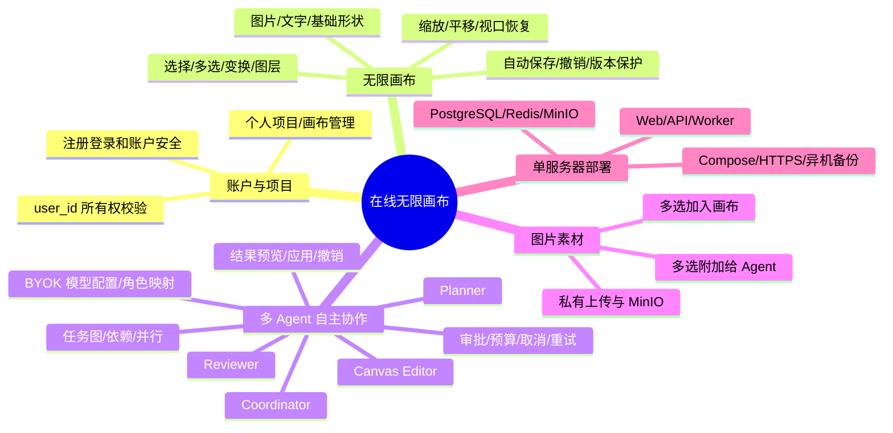
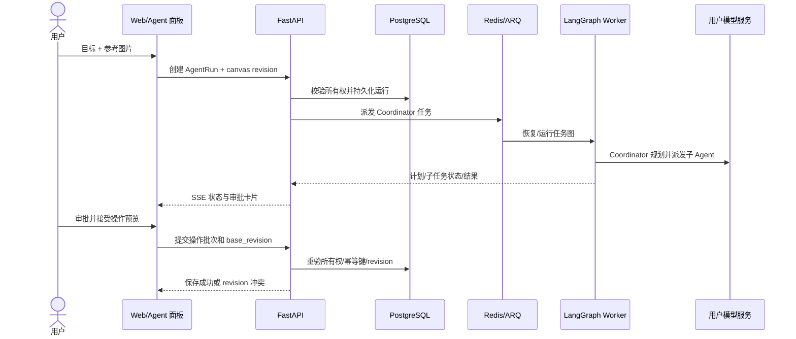

# 需求关系图

> MVP 核心：个人账户和项目、无限画布、图片素材、多 Agent 自主协作。

## 需求树

## 数据和能力映射

| 需求 | 主要数据/组件 | MVP 优先级 |
|---|---|---|
| 账户和会话 | users、sessions | P0 |
| 个人项目 | projects、owner_id | P0 |
| 画布文档和冲突保护 | canvases.document JSONB、revision、canvas_versions | P0 |
| 图片素材 | assets、StorageAdapter、MinIO | P0 |
| 用户模型配置 | model_configs（密钥加密） | P0 |
| Agent 角色 | agent_role_configs | P0 |
| Agent 父运行和子任务 | agent_runs、agent_tasks、tool_runs、checkpoints | P0 |
| 长任务 | Redis/ARQ、Worker、PostgreSQL 运行状态 | P0 |
| 多人实时编辑 | — | 当前不纳入 MVP |
| 外部生图/改图接口 | Image Creator 适配层预留 | 后续，等待用户接口文档 |

## Agent 执行流程

## 原型与规格对应

| 页面 | OpenSpec capability |
|---|---|
| 登录/注册/账户/项目 | identity-projects |
| 无限画布/保存/撤销 | canvas-editing |
| 图片库/上传/引用 | asset-storage |
| Agent 设置/任务树/审阅 | agent-orchestration |

UI 调试顺序：页面和账户 → 单用户画布 → 素材流 → 多 Agent 任务树与审批 → 保存失败/revision 冲突/任务错误状态。多人实时编辑暂不设计。
