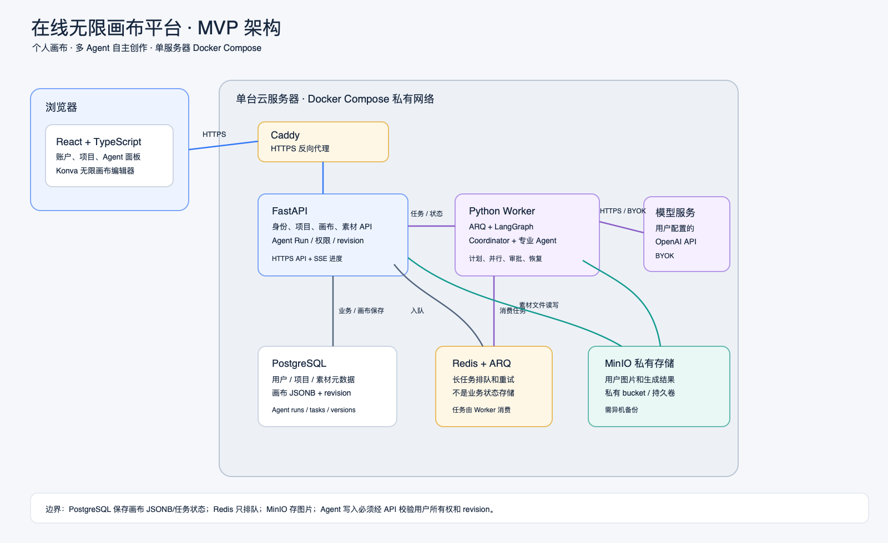
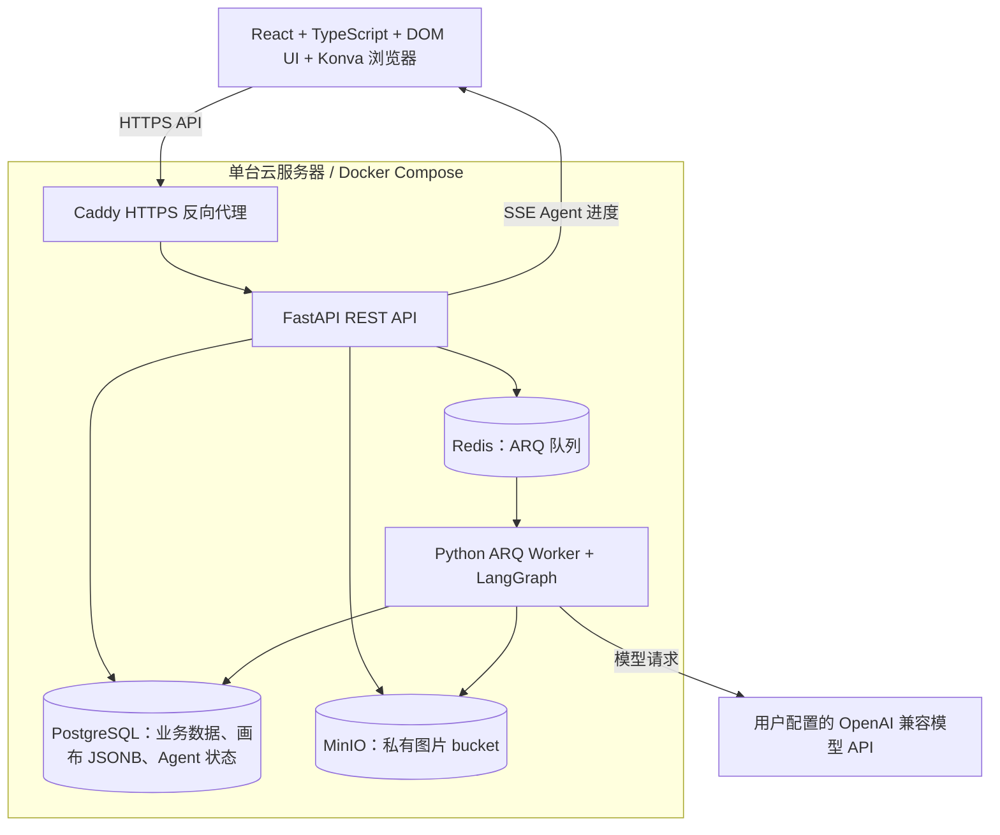
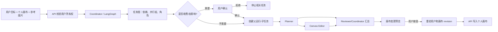
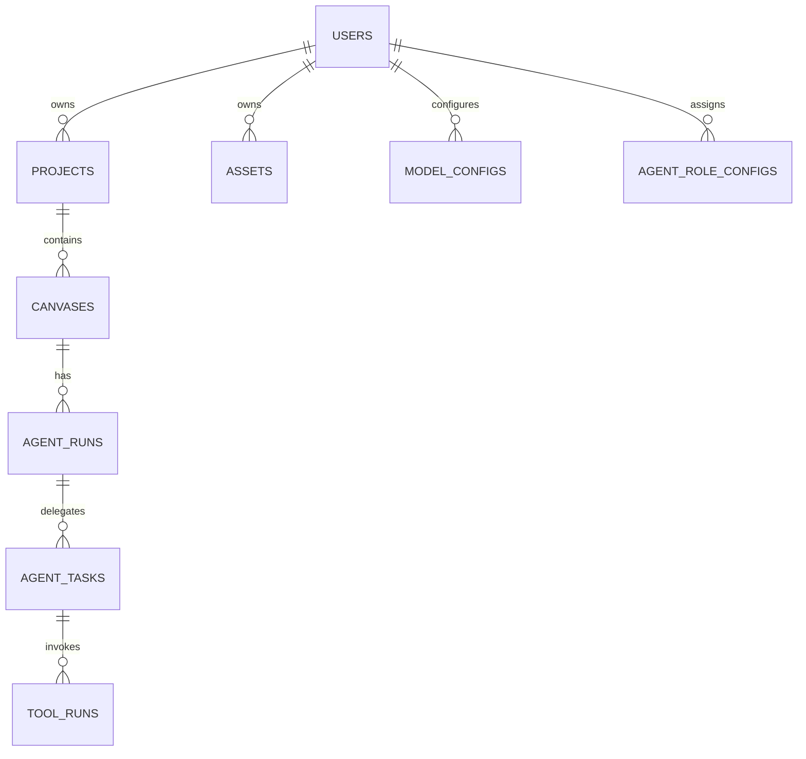

# 系统架构与数据设计

> 状态：MVP 技术方案 v1.1，2026-10-29。按单用户编辑与一台服务器 Docker Compose 设计。

## 1. 部署架构图

### 单机部署说明

- 对外只开放 HTTPS 反向代理；PostgreSQL、Redis、MinIO Console 只在 Compose 私有网络访问。
- Redis 只负责任务队列，不作为运行记录或最终状态的唯一存储。
- MinIO 与数据库同机存在共同故障域；图片和数据库定期备份到异机/外部对象存储并记录恢复流程。

## 2. 服务职责和数据流

| 服务 | 职责 | 持久状态 |
|---|---|---|
| Web | 账户、项目、无限画布、素材和 Agent 面板 | 浏览器临时草稿；正式保存走 API |
| API | 会话、所有权校验、项目/画布/素材、Agent 运行 API | PostgreSQL、MinIO |
| Worker | Coordinator/子 Agent 和长耗时工具 | PostgreSQL/LangGraph checkpointer，Redis 仅排队 |
| PostgreSQL | 业务事实来源、画布文档、Agent 运行/任务状态 | 数据卷 + 异机备份 |
| Redis | ARQ 任务分发、重试和取消信号 | 可重建队列状态 |
| MinIO | 上传图片、缩略图；未来保存图像 API 结果 | 数据卷 + 异机备份 |

## 3. 多 Agent 执行

### 怎么理解这个执行流程

它不是让几个 Agent 自己无限聊天，也不要求用户分别打开、管理多个 Agent。用户只发一次目标；Coordinator 是流程调度员，按任务依赖调用有明确职责的 Agent 节点。各节点可使用同一个已配置模型，也可按角色选择不同模型。

例如用户说“把这三张商品图排成一张海报”：

1. **Coordinator** 读取当前画布和被选中的三张图，建立有顺序的任务。
2. **Planner** 输出排版方案，例如主图、标题和留白位置。
3. **Canvas Editor** 把方案转换成允许的画布操作，不执行任意代码。
4. **Reviewer** 检查元素是否重叠、标题/图片层级是否符合要求，并汇总修改。
5. 用户先看变更预览，再接受或放弃；API 检查 revision 后保存。

MVP 的多 Agent 核心是“自动拆任务、按依赖调度、分别显示结果、失败可重试、写画布前可审阅”。当前已规划的可用角色是 Coordinator、Planner、Canvas Editor 和 Reviewer。可并行的任务只在相互独立时并行；共享画布的写操作按任务依赖顺序应用，不让两个 Agent 同时覆盖同一文档。

**生图和改图目前不在这条执行链内。**用户提供接口后，才增加 Image Creator 节点：它分别调用生图/改图 API，把结果存为 MinIO 素材，再让用户选择是否加入画布。接口接入清单见[接入预案](image-provider-integration.md)。

- `agent_runs` 保存一次用户目标；`agent_tasks` 保存子 Agent、依赖、状态、输入/输出摘要、错误和幂等键。
- LangGraph 管理任务图、人工审批中断和恢复；PostgreSQL checkpointer 持久化状态。
- Worker 经 API 的画布操作接口写入个人画布，不绕过 revision 检查直接覆盖 JSONB。
- 当前 Worker 不调用外部生图/改图 API。未来由 Image Creator 工具适配层调用用户提供的两类接口，结果先保存为私有素材，再由用户选择是否加入画布；接入预案见 `image-provider-integration.md`。
- 每次运行设置最大子任务数、并行数、循环次数、超时和预算。

## 4. 逻辑数据模型

| 实体 | 关键字段/约束 |
|---|---|
| `users` | id、username unique、password_hash、status、created_at |
| `projects` | id、owner_id、name、created_at |
| `canvases` | id、project_id、name、document JSONB、schema_version、revision、viewport JSONB |
| `canvas_versions` | canvas_id、revision、document snapshot、created_at；按保留策略清理 |
| `assets` | owner_id、object_key、mime_type、size_bytes、checksum、metadata |
| `model_configs` | owner_user_id、base_url、model_name、encrypted_api_key |
| `agent_role_configs` | owner_user_id、role_name、model_config_id、enabled、limits |
| `agent_runs` | project_id、canvas_id、user_id、status、goal、context_revision、summary |
| `agent_tasks` | run_id、parent_task_id、role、depends_on、status、output、idempotency_key |
| `tool_runs` | task_id、tool_name、parameters/result summary、approval、status |

图片二进制不进入 PostgreSQL。画布保存为带 schema_version 和 revision 的 JSONB 快照，可选版本表用于恢复；API 使用 base_revision 乐观并发保护旧内容。

## 5. 安全和隐私

- 所有 REST 请求校验当前 user_id 对项目、画布、素材和模型配置的所有权。
- Agent 任务凭证归属于发起用户；API Key 加密、使用时解密、不回传、不写日志。
- 每个工具执行前校验工具注册、参数 schema、资源归属、当前 revision 和幂等键。
- 自定义模型 URL 只允许经过 DNS/IP、端口和重定向校验的 HTTPS 公网目标，阻止 SSRF。
- 禁止模型输出直接执行任意代码、shell 或 SQL。

## 6. 单服务器成本与风险

- 服务进程：Web、API、Worker、PostgreSQL、Redis、MinIO、Caddy；单机 Compose 便于低成本启动，但不是高可用。
- Redis + ARQ 是 Agent 长任务的唯一队列，不增加 Kafka/RabbitMQ。
- PostgreSQL 作为业务/画布/任务持久状态；MinIO 只放图片文件。
- 配置备份到主机外，实施前要演练 PostgreSQL 与 MinIO 恢复。

## 7. 技术资料

- 前端视觉与页面实施顺序见[前端 UI 开发计划](frontend-ui-plan.md)。React + Konva 足以实现原型中的画布；页面导航和 UI 基础控件由 React Router、Tailwind、shadcn/ui 与 Lucide 补齐。
- 画布：Konva React。点阵底图用 CSS radial-gradient 同步 viewport；普通面板、工具栏、表单、弹层仍是 HTML/CSS。多用户实时协作不在 MVP，因此暂不引入 Yjs 或 Hocuspocus。
- 多 Agent：LangGraph 任务图和 PostgreSQL checkpoint；具体依赖版本在实现前核验。
- Context7 查询记录（2026-10-29，`/websites/langchain_oss_python_langgraph`）：LangGraph 使用 State/Nodes/Edges 表达流程，独立节点可并行；`interrupt` 与 checkpointer 可暂停并恢复审批。见[Graph API](https://docs.langchain.com/oss/python/langgraph/graph-api)、[Interrupts](https://docs.langchain.com/oss/python/langgraph/interrupts)、[Persistence](https://docs.langchain.com/oss/python/langgraph/persistence)。
- Context7 前端文档查阅（2026-10-29）：React Konva `/konvajs/react-konva`、Tailwind CSS `/tailwindlabs/tailwindcss.com`、shadcn/ui `/websites/ui_shadcn`、React Router `/remix-run/react-router`。Vite SPA 采用 BrowserRouter，Tailwind 用官方 Vite 插件与 CSS theme tokens，组件主题自定义。详见[ADR-0001](../03-decisions/ADR-0001-monorepo-and-stack.md)。
- 技术选择和替代方案见 [ADR-0001](../03-decisions/ADR-0001-monorepo-and-stack.md)。
