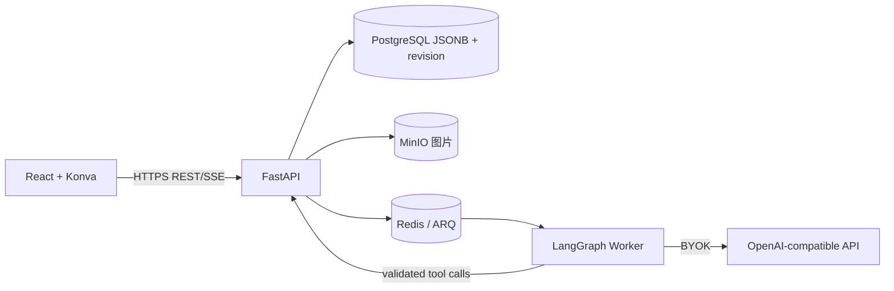

# ADR-0001：MVP Monorepo 与技术选型

- 状态：MVP 暂定采用；实施前锁定兼容版本和依赖许可。
- 日期：2026-10-29

## 背景

MVP 是个人使用的线上无限画布，包含账号、项目、图片素材和多 Agent 自主协作。当前明确暂不支持多人同时编辑，因此先采用 JSONB 文档和 revision 乐观并发，避免额外运行实时协作服务。

## 决策

1. **Monorepo：**pnpm workspace + Turborepo 管 TypeScript Web 与共享包；Python API/Worker 用 uv；根脚本统一开发和 Compose。
2. **Web：**React + TypeScript + Vite，单页应用。
3. **无限画布：**react-konva/Konva；平台定义自己的 CanvasDocument/command schema，不直接绑定 Konva 序列化格式。
4. **业务 API：**FastAPI + SQLAlchemy + Alembic 管账号、项目、画布、素材、Agent 运行 API。
5. **多 Agent：**LangGraph Python 管 Coordinator 和 Planner、Canvas Editor、Reviewer 子 Agent；任务图支持依赖、限额内并行、人工审批中断和持久恢复。Image Creator 等用户图像 API 提供后再接入。
6. **异步任务：**Redis + ARQ + Python Worker 执行 Agent 和长任务；任务运行/最终状态持久到 PostgreSQL。
7. **画布持久化：**PostgreSQL JSONB 存 CanvasDocument，含 schema_version、revision 和 viewport；保存用 base_revision 乐观并发检查，历史版本按保留策略保存。
8. **图片文件：**MinIO 私有 S3 bucket 同机部署；PostgreSQL 存 asset_id、对象键和元数据，文件经 StorageAdapter 访问。
9. **入口：**Caddy 提供 HTTPS 反向代理；服务在 Docker 私有网络通信。

## 技术职责图



## 选型理由与替代方案

- **Konva：**React 绑定覆盖图片、文字、形状和对象变换，适合自建编辑器。相较完整画布 SDK，授权/托管依赖更少；缺点是对齐辅助、多选、撤销和交互细节需自己实现。
- **JSONB + revision：**单用户编辑和自动保存实现简单，PostgreSQL 可直接备份/版本化。暂不使用 CRDT，因为 MVP 没有多人实时同步需求。
- **LangGraph：**状态图适合 Coordinator、子 Agent 依赖/并行和可恢复人工审批；替代方案是自写状态机，但恢复/检查点需自行维护。
- **Redis + ARQ：**已有 Python Worker 生态，足够运行首版长任务；暂不引入 Kafka/RabbitMQ。
- **MinIO：**符合单机低成本目标并提供 S3 API；对象存储服务可通过 StorageAdapter 替换。

## 单机中间件清单

| 组件 | MVP 是否需要 | 职责 |
|---|---:|---|
| PostgreSQL | 是 | 用户、项目、画布 JSONB、版本、Agent 状态 |
| MinIO | 是 | 用户图片和未来生成/编辑结果；私有 bucket |
| Redis + ARQ | 是 | 多 Agent 和长耗时任务排队/重试 |
| Python Worker | 是 | 执行 LangGraph 和耗时工具 |
| Caddy | 是 | HTTPS 反向代理 |
| Hocuspocus / Yjs | 否 | 专用于多人实时文档同步，本 MVP 不做多人编辑 |
| Kafka/RabbitMQ | 否 | 当前 Redis/ARQ 足够 |
| 向量数据库 | 否 | 首版没有长期知识检索需求 |

## 代价和风险

- TS/Python 双语言增加开发工具复杂度 → 固定运行时、锁文件和根级脚本。
- JSONB revision 不能支持多人同时编辑 → 该能力已明确排除；未来要支持时另行设计 CRDT/冲突处理和数据迁移。
- 多 Agent 重试可能重复副作用 → 素材写入、画布命令使用幂等键；后续接图像 API 时也需为外部调用设计幂等/重试策略。
- 多 Agent 并发可能增加模型费用 → 限制并发、超时、循环和每次运行预算。
- 生图/改图外部协议尚未提供 → 当前只保留 Image Creator 适配边界，收到用户接口文档后再确定鉴权、异步任务、费用和重试规则。
- MinIO 与 PostgreSQL 同机故障域 → 配置异机备份并进行恢复演练。

## Context7 文档核对

- 2026-10-29 查询 LangGraph Python 文档，Context7 library ID：`/websites/langchain_oss_python_langgraph`。
- 本设计按 State/Nodes/Edges 表达 Coordinator 工作流，独立节点在明确依赖下并行；人工确认使用 interrupt/checkpointer 暂停与恢复。
- 实现时遇到具体 LangGraph API、checkpoint 或流式事件用法，再按锁定版本重新查询 Context7，不直接复制旧示例。

## Monorepo 草图

```text
apps/web              # React + Vite + Konva 前端
apps/api              # FastAPI 账户/项目/素材/Agent API
apps/worker            # ARQ + LangGraph 多 Agent/长任务
packages/canvas-core   # 画布类型、命令和校验
packages/api-client    # 类型化 API client
packages/ui            # 共享 UI 组件
infra/                 # Compose、Caddy、Postgres、Redis、MinIO、备份
docs/ openspec/         # 产品、技术设计和行为规格
```

## 后续决策

- 开始实现前锁定依赖版本并复核其官方 API/许可。
- 产品设计完成后由用户重画原型，再进行 UI 前端调试；后端实施随 OpenSpec tasks 推进。
