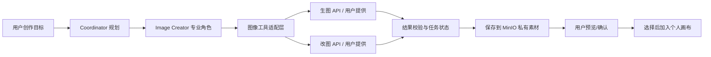

# 生图与改图 API 接入预案

> 状态：供应商接入仍待用户提供接口；代码已实现与供应商无关的 Provider 协议和未配置默认适配器，不预设供应商或请求格式。

## 目标

为后续图像服务提供统一的服务端适配边界，分别支持“根据文本/参考图生成图片”和“基于输入图片执行修改”。底栏生图参数已通过 Agent 运行进入 Worker；当前 Provider 未配置，不会发起供应商请求或返回伪造图片。

## 未来调用关系

## 设计边界

- 底栏提交生成请求时，API 创建持久化的 Image Creator 任务；Worker 通过服务端 Provider 发请求，不让浏览器持有外部 API 密钥。一般画布目标仍走 Coordinator 多 Agent 任务图。
- 生图和改图是两个独立能力，分别定义输入、异步状态、结果、错误与重试语义。
- 外部接口成功返回不等于画布自动变更。先验证响应和图片文件、保存为用户私有素材，再让用户预览和选择是否插入画布。
- 长任务使用现有 ARQ Worker；图像参数、任务状态、幂等键、错误和结果引用持久化到 PostgreSQL；图片字节写 MinIO。生成输出标记为临时素材，用户保存后才加入素材库。
- 接入层封装供应商请求和响应转换，避免供应商字段进入画布核心模型和 Agent 通用任务 schema。
- 费用、速率限制、超时、重试和高影响审批按接口真实行为补充，不在缺少协议时猜默认值。

## 等用户提供接口后需要获取

1. 接口文档地址、服务版本、Base URL 和环境（测试/生产）。
2. 生图接口和改图接口各自的路径、HTTP 方法、鉴权方式、请求字段和响应 schema。
3. 输入/输出图片格式、尺寸/文件限制、参考图与 mask 等参数的支持情况。
4. 同步还是异步；若异步，任务创建、状态查询、回调、取消和超时规则。
5. 错误码、限流、重试安全性、幂等键支持及供应商费用/用量规则。
6. API Key 的归属与保存方式：由平台配置还是每位用户自备；访问区域/网络约束。
7. 输出结果的临时 URL 有效期、下载方法、内容校验和版权/数据保留要求。

## 文档核对方式

收到接口文档后，先按用户提供的接口规范核对真实协议；若实现涉及 OpenAI 兼容 SDK、HTTP 客户端、队列或对象存储 API，再通过 Context7 查询对应库的准确版本文档，并把日期、版本和官方依据补入 ADR/实现说明。

## 当前状态

- `apps/api/canvas_api/providers/images.py` 定义 `ImageGenerationProvider` 协议、请求/结果结构和 `UnconfiguredImageProvider`。
- `POST /api/agent/runs` 可携带模型 ID、质量、宽高、16 倍数对齐、分辨率、宽高比、透明背景和生成数量；API 持久化参数并创建 Image Creator 任务。
- Worker 向抽象 Provider 传入参数和已授权参考图字节。默认实现返回“当前没有配置生图服务”，不联网；注入 Provider 后，返回文件需通过 MIME/格式/尺寸校验，保存为用户私有临时素材并由 Agent 面板展示，不自动修改画布。
- 用户可选择把临时图片加入画布或显式保存进素材库。类型化 `POST /api/generations` 仍供服务端集成使用；改图端点尚未接入。
- 未决项：具体服务商、协议字段、异步/计费/取消语义、请求规模和 API Key 归属，待用户提供接口文档。
