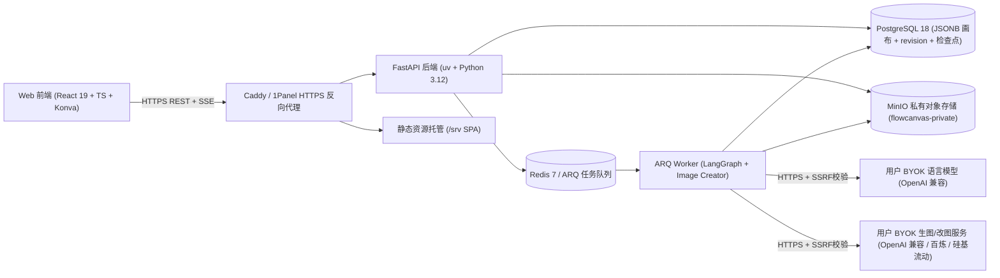

# ARCHITECTURE.md：技术与安全约束

> 状态：6 服务生产自托管架构已定稿；当前正在按 [`zhixing-quiz`](../../../../zhixing-quiz) 标准补全生图 Provider、工具白名单、前端 SSE、全量 UI 重构与 Pytest 自动化测试。详细目录、表结构与接口契约见 [`docs/02-design/system-architecture.md`](02-design/system-architecture.md)。

## 整体部署形态

单台云服务器通过 **Docker Compose** 运行 **Web/Caddy、FastAPI API、ARQ LangGraph Worker、PostgreSQL 18、Redis 7 与 MinIO** 6 个核心服务；对外可通过内置 Caddy 自动申请 TLS 证书，也可由宿主机 **1Panel（Nginx）** 终止公网 HTTPS 后反代至容器入口。



## 锁定技术栈

- **Monorepo**：`pnpm` (`10.x`) workspace + Turborepo（前端与共享 TS 包）；Python 后端与 Worker 统一由 `uv` 管理。
- **Web 前端**：React 19 + TypeScript + Vite + React Router 7 + Tailwind CSS 4 + Lucide React + `react-konva` / Konva。
- **API 后端**：Python 3.12 + FastAPI + SQLAlchemy 2.x（异步）+ Alembic + Pydantic v2 + `httpx` + `cryptography`。
- **异步编排与队列**：Redis 7 + ARQ + LangGraph（`StateGraph` + `langgraph-checkpoint-postgres` / SQLite 开发态回落）。
- **存储与对象库**：PostgreSQL 18（开发态支持 SQLite 回落）+ MinIO S3 兼容私有桶（开发态支持本地目录回落）。
- **测试与质量**：`ruff`、`pytest` + `pytest-asyncio` + `httpx`（后端全 Mock 外部 API）、`tsc` + Vite build + Playwright（前端与 E2E）。

## 代码分层与依赖边界

```text
apps/web/              React 路由页面、Konva 画布引擎、SSE 进度消费、BYOK 设置与资产 UI
apps/api/canvas_api/   FastAPI 入口、数据模型、Alembic 迁移、工具注册表、存储与加密、Provider 适配器
apps/worker/canvas_worker/  ARQ 任务入口、LangGraph 四角色编排、生图任务执行、孤立任务清理与检查点
packages/canvas-core/  前后端共享画布文档 schema 与操作类型定义
packages/api-client/   前端类型化 REST + SSE 请求封装
infra/                 Docker Compose、Caddyfile、MinIO 初始化与备份恢复脚本
```

- **单向控制流**：浏览器永远不直接持有或访问外部模型原始响应与 MinIO 私有凭据；所有上传、素材读取、生图与 Agent 调用必须经过 FastAPI 鉴权与所有权校验。
- **前端样式门控**：修改 `apps/web` 页面视觉与交互布局前，必须先更新 [`docs/02-design/prototypes/`](02-design/prototypes/README.md) 下的交互式 HTML 原型并经用户确认。

## 数据边界与一致性设计

- **画布唯一事实来源与本地异步缓存**：PostgreSQL `canvases` 表以 JSONB 存储 `document` 与 `viewport`，配合整型 `revision` 实现乐观并发控制（保存与提案应用均校验 `base_revision`，冲突返回 `409`），同时在 `canvas_versions` 留存历史快照支持回滚。浏览器端未同步草稿与本地撤销栈采用 **异步 IndexedDB（500ms 防抖写入）**，不阻塞主线程与画布拖动帧率。
- **Konva 高性能画布渲染边界**：遵循 Konva 官方性能规范（Context7 `/konvajs/site`），拖动中的画布节点移入独立 `dragLayer`，非交互背景层关闭事件监听（`listening={false}`），图片与卡片关闭 `perfectDrawEnabled`，拖动帧内严禁触发 React `setState`。
- **私有对象存储**：图片二进制存放在 MinIO 私有桶（无匿名公网访问），数据库 `assets` 表保存 `owner_id`、对象键、`sha256`、宽高与 `temporary` 状态；画布对象通过 `asset_id` 与代理地址 `/api/assets/{id}/content` 引用。
- **Agent 状态与续跑**：`agent_runs`、`agent_tasks`、`run_events` 与 LangGraph checkpoint 均持久化在 PostgreSQL；Worker 异常重启或被强杀后，可基于检查点从已完成阶段续跑，并按条件扣减 `model_call_budget`；节点通过 LangGraph `stream_mode=["updates", "custom"]` (`version="v2"`) 与 `get_stream_writer()` 发射思考流与结构化工具状态。
- **工具白名单约束**：Agent 仅允许提出 [`tools.py`](../apps/api/canvas_api/tools.py) 登记的受限操作（`generate_image`、`edit_image`、`add_note`、`move_object`、`resize_object`、`align_objects`、`add_shape`），无需引入 RAG 切分；画布修改类操作经 Pydantic 校验后作为待审提案返回，用户确认后由 API 事务性写入画布并支持整批撤销。

## 安全红线与禁止引入清单

- **生产密钥与会话门禁**：`APP_ENV=production` 时要求 `APP_SECRET_KEY >= 32` 字符且非默认值，并强制 `COOKIE_SECURE=true`；会话 Cookie 使用 `HttpOnly` + `SameSite`。
- **BYOK 加密与防 SSRF**：语言模型与生图模型 API Key 均在服务端加密落库且接口永不回显；所有自定义 `base_url` 必须经过 `validate_public_https_url` 解析校验，拒绝 `http://`、本机、内网 IP 与链路本地地址。
- **日志脱敏**：`audit_events` 与异常日志严禁写入用户密码、API Key、完整提示词或请求正文。
- **SSE 代理约束**：Caddy 与任何前置 Nginx/1Panel 反代必须关闭响应缓冲（`flush_interval -1` / `proxy_buffering off`），避免 `/api/agent/runs/{id}/events` 流式事件卡顿。
- **明确禁止引入**：禁止引入 Yjs/Hocuspocus 多人协同 WebSocket、浏览器直连第三方生图 Key、未经过白名单的任意代码/表达式执行、以及跨库冗余 ORM 混合写法。
