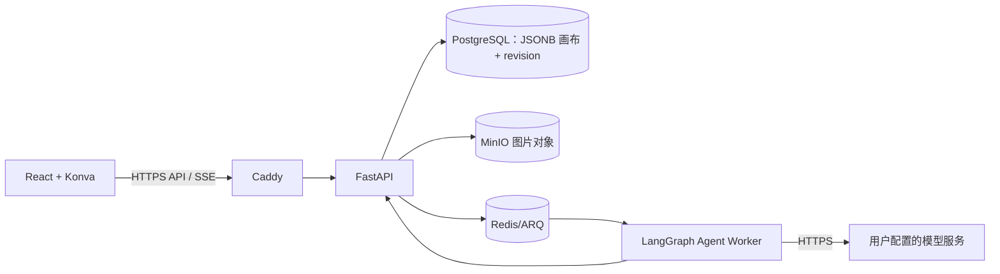

# ARCHITECTURE.md：技术边界

> 状态：单用户编辑的 MVP 技术基线；Hocuspocus/Yjs 实时协作暂不纳入。

## 部署形态

一台服务器通过 Docker Compose 运行 Web、FastAPI API、Python Agent Worker、PostgreSQL、Redis、MinIO 和 HTTPS 反向代理。数据库与 MinIO 必须异机备份；首版不做高可用。



## 技术选择

| 范围 | MVP 选择 | 主要职责 |
|---|---|---|
| Monorepo | pnpm workspace + Turborepo；Python 用 uv | 统一 TS 工作区与 Python 服务入口 |
| Web | React + TypeScript + Vite | 单页应用、账户、项目和编辑器 |
| 画布 | react-konva / Konva | 图片、文字、形状、变换和命中检测 |
| API | FastAPI + SQLAlchemy + Alembic | 身份、项目、素材和 Agent REST API |
| 多 Agent | LangGraph Python | Coordinator 任务图、子 Agent、审批和断点恢复 |
| Worker/队列 | Redis + ARQ + Python Worker | Agent 长任务、重试和取消；未来可运行图像 API 工具 |
| 业务数据 | PostgreSQL | 用户、项目、画布 JSONB、revision、Agent 状态 |
| 图片存储 | MinIO 私有 S3 bucket | 图片文件、缩略图和生成结果 |
| HTTPS | Caddy | TLS、HTTP 反向代理和 SSE |

## 数据边界

- PostgreSQL 是业务事实来源；画布文档用 JSONB、schema_version 和 revision。
- 保存使用 base_revision 乐观并发检查，避免多个标签页或设备的旧文档静默覆盖新文档。
- 图片二进制放 MinIO；数据库只存素材归属、对象键和元数据；画布按 asset ID 引用。
- Redis/ARQ 负责 Agent 长任务排队；运行状态和最终结果持久化在 PostgreSQL。
- Agent 只通过 API 登记的工具操作画布；检查 revision 后写回，不直写数据库快照。
- 不引入 WebSocket 协作服务、CRDT、光标 presence 或成员邀请模型。

## 安全边界

- 密码仅存哈希，会话用安全 Cookie；资源 API 按 user_id 校验所有权。
- BYOK 密钥服务端加密，不回传、不写日志；自定义模型地址仅允许经过 SSRF 校验的 HTTPS 公网目标。
- Agent 工具白名单、参数 schema、幂等键、预算/并发限制和高影响操作确认。
- MinIO bucket 私有、Console 不对公网开放；PostgreSQL 和 MinIO 备份至主机外。

## Monorepo 模块

```text
apps/web        React、账户/项目、Konva 画布和 Agent UI
apps/api        FastAPI 身份、项目、素材、Agent API
apps/worker     ARQ + LangGraph 多 Agent 和长任务
packages/canvas-core   画布文档类型、命令和校验
packages/api-client    Web 调用契约
packages/ui            共用界面组件
infra                 Compose、Caddy、数据库和备份配置
```

完整部署/数据关系见[系统架构](02-design/system-architecture.md)，选型取舍见[ADR-0001](03-decisions/ADR-0001-monorepo-and-stack.md)。
